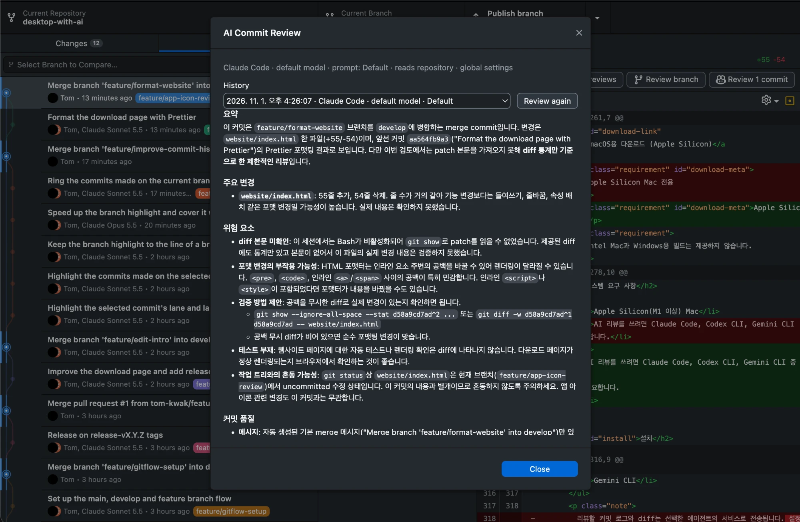
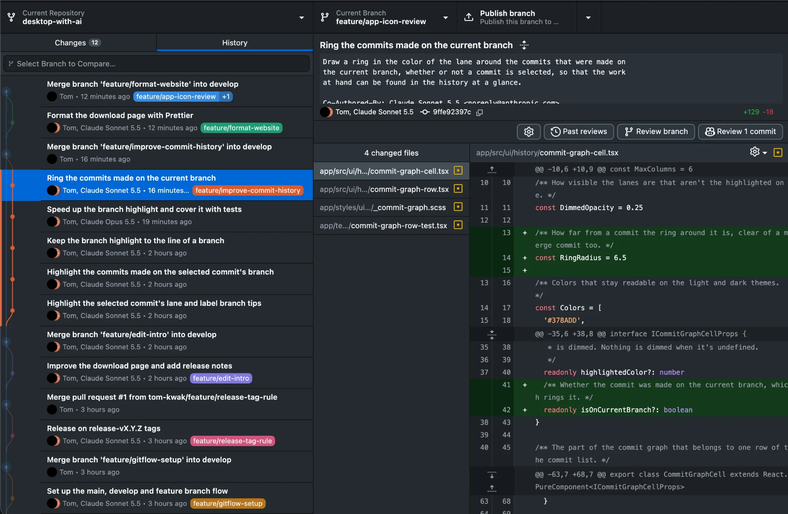

# [ReviewDesk](https://tom-kwak.github.io/desktop-with-ai/)

[ReviewDesk](https://tom-kwak.github.io/desktop-with-ai/)는 커밋과 브랜치를 AI로 리뷰하는
오픈 소스 데스크톱 Git 클라이언트입니다. [GitHub Desktop](https://github.com/desktop/desktop)을
포크해서 AI 리뷰, 커밋 그래프, GitLab 연동(머지 리퀘스트 리뷰와 머지)을 더했고, 기존 기능은
그대로 동작합니다.
[Electron](https://www.electronjs.org/) 기반이며 [TypeScript](https://www.typescriptlang.org)와
[React](https://reactjs.org/)로 작성되었습니다.



> 개인 포크이며 GitHub의 공식 제품이 아닙니다. 문제는 GitHub Desktop이 아니라
> [이 저장소](https://github.com/tom-kwak/desktop-with-ai/issues)에 알려 주세요.

## 어디서 받을 수 있나요?

### Quick Start

Apple Silicon Mac에서 터미널에 붙여 넣으면 최신 버전이 설치됩니다. 앱이 실행 중이면 먼저 종료하세요.
업데이트할 때도 같은 명령을 씁니다.

```bash
curl -L https://github.com/tom-kwak/desktop-with-ai/releases/latest/download/ReviewDesk-arm64.zip -o /tmp/ReviewDesk.zip && unzip -oq /tmp/ReviewDesk.zip -d /Applications && xattr -dr com.apple.quarantine /Applications/ReviewDesk.app
```

이 명령은 최신 버전을 받아 `/Applications`에 설치하고, 공증을 받지 않은 앱에 macOS가 띄우는
"확인되지 않은 개발자" 경고를 건너뛰도록 격리 표시(`xattr`)를 지웁니다.

### 직접 내려받기

 - [macOS (Apple silicon)](https://github.com/tom-kwak/desktop-with-ai/releases/latest/download/ReviewDesk-arm64.zip)

압축을 풀고 `ReviewDesk.app`을 응용 프로그램 폴더로 옮긴 뒤, 막히면 시스템 설정의
개인정보 보호 및 보안에서 허용하세요. Intel Mac, Windows, Linux 빌드는 제공하지 않습니다.

### 지난 릴리스

지난 버전과 변경 내역은 [Releases](https://github.com/tom-kwak/desktop-with-ai/releases)에서 볼 수 있습니다.

### 설치 후 확인할 것

 - 실행 중에는 앱을 옮기지 마세요. 옮기면 내장 Git을 찾지 못합니다. 옮겼다면 앱을 종료하고 다시 실행하세요.
 - AI 리뷰를 쓰려면 [Claude Code](https://claude.com/claude-code)를 설치하고 터미널에서 로그인해 둡니다.
 - GitLab을 쓰려면 설정 > Accounts > GitLab에서 `Enable GitLab integration`을 켜고, 서버 주소와
   개인 액세스 토큰(PAT)으로 로그인합니다. 토큰에는 `api` 권한이 필요합니다(읽기만 하려면 `read_api`).

## 무엇이 추가되었나요?

 - **AI 리뷰**: History 위쪽 바에서 선택한 커밋(`Review N commits`)이나 현재 브랜치(`Review branch`)를
   리뷰합니다. 결과는 요약, 주요 변경, 위험 요소, 커밋 품질로 정리됩니다. API 키 없이 컴퓨터에
   설치되고 로그인된 에이전트 CLI를 실행합니다.
   - Claude Code: 기본값이며 동작을 확인했습니다.
   - Codex CLI, Gemini CLI: 선택할 수 있지만 끝까지 실행해 보지 못했습니다.
 - **저장소를 읽는 리뷰**: 설정에서 `Let the agent read files in the repository`를 켜면 diff 밖의
   코드도 참고합니다. Claude Code 전용이고 읽기 도구만 허용하며 기본값은 꺼짐입니다. 읽은 내용은
   에이전트 서비스로 전송됩니다.
 - **리뷰 이력**: 리뷰는 자동 저장되고, 같은 입력이면 저장된 리뷰를 다시 보여 줍니다
   (`Review again`으로 새로 실행). `Past reviews`에서 SHA, 메시지, 브랜치, 내용, 에이전트로 찾습니다.
   이 컴퓨터에만 저장되며 암호화하지 않습니다.
 - **리뷰 설정**: 톱니바퀴 버튼에서 에이전트, 모델, 저장소 읽기, 프롬프트(수정, 추가)를 정합니다.
   전체 기본값과 프로젝트별 설정이 따로 있습니다.
 - **커밋 그래프**: History 목록 왼쪽에 브랜치 흐름을 그리고, 커밋을 선택하면 같은 브랜치의 커밋을
   강조합니다. 브랜치 이름 칩과 현재 브랜치 링도 표시됩니다.
 - **GitLab 연동**: GitHub 기능과 나란히 동작하며 설정에서 켜고 끕니다(기본값은 꺼짐).
   gitlab.com과 사내 GitLab 서버(하위 경로 설치 포함)를 지원합니다. 아래에 자세히 정리했습니다.

### GitLab 연동

GitLab 기능은 스위치를 켜고 GitLab에 로그인했을 때만 나타납니다. 끄면 GitHub Desktop과 같게 동작합니다.

| 영역 | 할 수 있는 일 |
| --- | --- |
| 로그인 | 서버 주소와 PAT로 로그인합니다. 서버마다 계정 하나씩, 여러 서버를 함께 쓸 수 있습니다. 토큰은 macOS 키체인에만 저장합니다. |
| 클론 | Clone 대화상자의 **GitLab** 탭에서 내가 속한 프로젝트를 그룹별로 보고 검색해 클론합니다. |
| Git 인증 | 로그인한 GitLab 서버로 clone, fetch, push 할 때 저장된 토큰을 써서 비밀번호를 묻지 않습니다. |
| 진입 | 저장소의 remote가 로그인한 GitLab 프로젝트이면 툴바에 **Merge Requests** 버튼이 나타납니다. |
| 목록 | Open / Merged / Closed / All, 내가 만든 MR, 나에게 리뷰 요청된 MR로 거르고 검색합니다. 현재 브랜치의 MR로 바로 가거나 새로 만들 수 있습니다. |
| 생성 | 현재 브랜치로 MR을 만듭니다. 제목과 설명(커밋 목록)을 미리 채우고 Draft, 리뷰어를 고릅니다. 같은 브랜치로 머지, 푸시하지 않은 브랜치, 이미 열린 MR 같은 문제는 만들기 전에 이유를 보여 줍니다. |
| 리뷰 | 설명과 코멘트를 markdown으로 보여 주고 `!12`, `#3`, `@user`를 링크로 바꿉니다. 승인/취소, 스레드 답글과 resolve, 승인·리뷰 요청·커밋 추가 같은 기록을 타임라인으로 봅니다(All / Comments / History). |
| Changes | 파일별 diff에서 줄을 골라 코멘트를 달고, 바로 올리거나 리뷰 초안으로 모아 한 번에 제출합니다. 라인 코멘트는 해당 코드와 함께 보입니다. |
| 머지 | 파이프라인 상태와 머지 가능 여부를 보여 줍니다. squash, 소스 브랜치 삭제 옵션으로 머지하고, 파이프라인 진행 중이면 자동 머지, 필요하면 리베이스합니다. |
| CI/CD | 툴바 버튼에 현재 브랜치의 최신 파이프라인 상태를 보여 줍니다. MR의 **Pipelines** 탭에서 단계별 job, job 로그를 보고, job 재시도·취소·수동 실행과 파이프라인 재시도·취소를 합니다. 실행 중이면 저절로 새로 읽습니다. |
| 관리 | 제목·설명 수정, Draft/Ready 전환, 리뷰어·담당자 지정, 닫기와 다시 열기를 합니다. |
| 편집기 | 코멘트와 설명은 Write / Preview 탭, 서식 버튼, `⌘B` `⌘I` `⌘K` 단축키, 목록 이어쓰기를 지원하고 `⌘Enter`로 올립니다. |

MR 창은 GitLab 색을 쓰는 별도 스타일이며 다크 테마를 지원합니다. 작업 후와 열려 있는 동안
30초마다 내용을 새로 읽습니다.



## ReviewDesk가 나에게 맞을까요?

GitHub Desktop을 쓰면서 커밋이나 브랜치를 올리기 전에 AI에게 한 번 검토받고 싶은 사람, 그리고
GitLab 머지 리퀘스트를 브라우저 대신 데스크톱에서 리뷰하고 머지하고 싶은 사람에게 맞습니다.
지금은 다음 한계가 있습니다.

 - macOS Apple Silicon 빌드만 제공합니다. Windows 코드는 시험하지 않았습니다.
 - 업스트림 병합을 쉽게 하려고 앱 안에 "GitHub Desktop" 문구를 그대로 두었습니다.
 - 한 번에 보내는 diff는 12만 자, 커밋 로그는 4만 자까지이고 넘으면 잘립니다.
 - GitLab은 머지 리퀘스트 중심입니다. 이슈, MR 없는 브랜치의 파이프라인 상세, GitLab에서 저장소 만들기(Publish)는
   지원하지 않고, GitLab 저장소에서 AI 리뷰 결과를 MR 코멘트로 올리는 기능도 아직 없습니다.
 - GitLab 로그인은 PAT만 지원합니다(OAuth 없음). 비공개 프로젝트의 이미지는 MR 창에서 보이지 않을 수
   있고, 이모지 단축어(`:+1:`)는 글자 그대로 나옵니다.
 - GitLab 기능은 GitLab 19.5 로컬 서버에서 확인했습니다. Premium 이상의 기능(승인 규칙, 머지 트레인 등)은
   다루지 않습니다.

GitHub Desktop 자체의 방향은 [이 문서](docs/process/what-is-desktop.md)에서 볼 수 있습니다.

## 문제가 생겼어요

먼저 [열린 이슈](https://github.com/tom-kwak/desktop-with-ai/issues?q=is%3Aopen)와
[닫힌 이슈](https://github.com/tom-kwak/desktop-with-ai/issues?q=is%3Aclosed)에서 이미 보고된
문제인지 찾아보세요. GitHub Desktop에서 이어받은 [알려진 문제](docs/known-issues.md)에는
해결 방법이 있는 경우도 있습니다.

맞는 이슈가 없으면 [새 이슈](https://github.com/tom-kwak/desktop-with-ai/issues/new/choose)를 열고
템플릿에 맞춰 조사에 필요한 정보를 적어 주세요. AI 리뷰 문제라면 쓰고 있는 에이전트 CLI와 버전을
함께 알려 주면 도움이 됩니다.

## 어떻게 기여할 수 있나요?

[CONTRIBUTING.md](./.github/CONTRIBUTING.md)에서 개발 환경과 소스 구조를 익힐 수 있고,
[docs](docs/) 폴더에 더 많은 자료가 있습니다.

### 브랜치와 릴리스

| 브랜치 | 역할 |
| --- | --- |
| `main` | 제품 브랜치. 릴리스는 여기서만 나갑니다. |
| `develop` | 기능을 합치고 검증하는 기준 브랜치입니다. |
| `feature/{기능명}` | `develop`에서 만들어 PR로 `develop`에 합칩니다. |

릴리스는 GitHub의 Actions 탭에서 [ReviewDesk release](.github/workflows/reviewdesk-release.yml)를
열고 **Run workflow**에 버전(예: `1.2.0`)을 넣어 실행합니다. 워크플로가 순서대로 처리합니다.

1. 버전 형식, 같은 태그가 없는지, `develop` 최신 커밋에서 ReviewDesk CI가 통과했는지 확인합니다.
2. `main`을 `develop`으로 fast-forward 합니다. 머지 커밋을 만들지 않으므로 릴리스 시점에 두 브랜치가
   같은 커밋이고, `main`을 `develop`으로 다시 합칠 필요가 없습니다.
3. 그 커밋에 `release-vX.Y.Z` 태그를 달고 앱을 빌드해 Release에 올립니다.

확인에 하나라도 실패하면 아무것도 바꾸지 않고 멈춥니다. `Dry run`을 켜면 확인만 합니다. `main`에
`develop`에 없는 커밋이 있으면 fast-forward가 안 되므로, 먼저 `main`을 `develop`에 합친 뒤 다시
실행합니다. `main`의 커밋에 `release-vX.Y.Z` 태그를 직접 푸시해도 빌드됩니다(`main`에 없는 커밋이면
실패합니다).

PR은 [ReviewDesk CI](.github/workflows/reviewdesk-ci.yml)(타입 체크, 서식, 린트, 테스트)가 확인하고,
소개 페이지([`website/`](website/))는 `main`에 푸시하면 배포됩니다.

## ReviewDesk 빌드하기

환경 준비는 [`setup.md`](./docs/contributing/setup.md)를 따릅니다.

```bash
yarn && yarn build:dev && yarn start        # 개발판 실행
RELEASE_CHANNEL=development yarn build:prod && RELEASE_CHANNEL=development yarn package   # dist/에 앱 생성
```

`RELEASE_CHANNEL=development`를 빼면 앱이 Apple 서명을 요구하고 공식 GitHub Desktop으로
자동 업데이트될 수 있습니다.

## 더 알아보기

[소개 페이지](https://tom-kwak.github.io/desktop-with-ai/)에서 기능을 화면과 함께 볼 수 있습니다.

기본 Git 기능의 설정, 인증, 사용법은 GitHub Desktop의
[시작하기 문서](https://docs.github.com/en/desktop/overview/getting-started-with-github-desktop)가
그대로 적용됩니다.

## License

**[MIT](LICENSE)**

The MIT license grant is not for GitHub's trademarks, which include the logo
designs. GitHub reserves all trademark and copyright rights in and to all
GitHub trademarks. GitHub's logos include, for instance, the stylized
Invertocat designs that include "logo" in the file title in the following
folder: [logos](app/static/logos).

GitHub® and its stylized versions and the Invertocat mark are GitHub's
Trademarks or registered Trademarks. When using GitHub's logos, be sure to
follow the GitHub [logo guidelines](https://github.com/logos).
